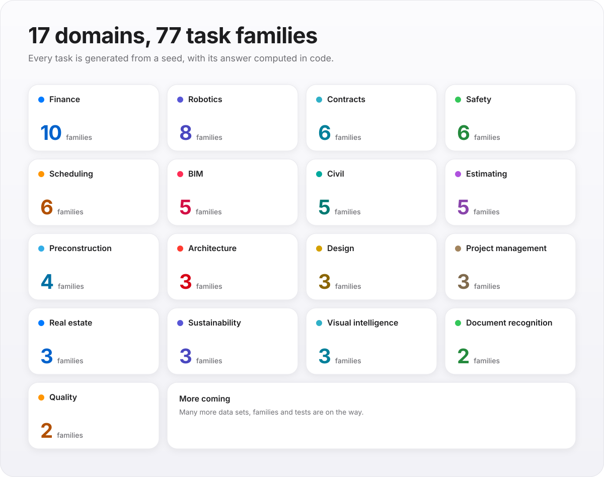
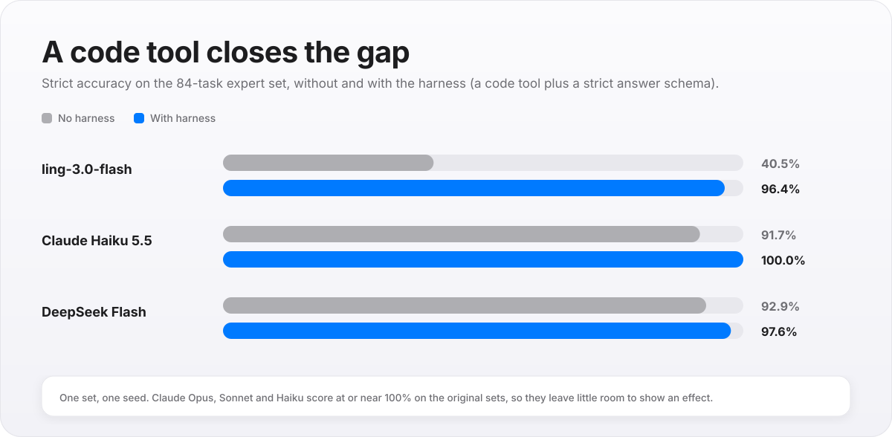
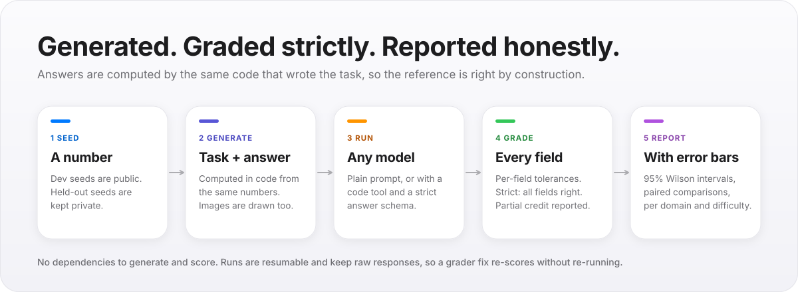

# ConstructBench

**An open benchmark of AI models on construction and the built world.** The calculations, checks and readings people in
the industry do every day: quantity takeoff, critical path, earned value, retainage, occupant load, IFC quantities,
clash detection, delay claims and more. Every task is generated from a seed with its answer computed in code, so
references are right by construction, a new seed gives a fresh unseen set, and scores are broken down by domain so a
result says *where* a model is strong or weak.

[](https://github.com/constructelligence-lab/constructbench/actions/workflows/tests.yml)
   

> **Status: early, and growing fast.** Many more data sets, task families and tests are being added. Today: 77 task
> families in 17 domains, 161 tests, and results for Claude, DeepSeek and open-weight models. Numbers in this README
> are copied from [`docs/LEADERBOARD.md`](docs/LEADERBOARD.md), which is generated from the tracked result files.

<p align="center">
  <picture>
    <source media="(prefers-color-scheme: dark)" srcset="assets/domains-dark.svg">
    
  </picture>
</p>

## What it found so far

<p align="center">
  <picture>
    <source media="(prefers-color-scheme: dark)" srcset="assets/tool-use-effect-dark.svg">
    
  </picture>
</p>

- **Tool use, not model size, explained most of the gap on small models.** On the 84-task expert set, a code tool plus a strict
  answer schema lifted ling-3.0-flash from **40.5% to 96.4%**, Claude Haiku 5.5 from 91.7% to 100%, and DeepSeek Flash from
  92.9% to 97.6%.
- **Frontier Claude models are at the ceiling on the original sets** (Opus, Sonnet and Haiku at or near 100% on the
  41- and 51-task sets), so those sets do not separate them. That is why the harder expert sets exist and why more
  families are coming. We say so rather than quote a leaderboard that hides it.
- **Caveats matter:** one seed per set, some runs stopped at a cost cap and are reported as not run, and `quick-families`
  was a development set. All of it is spelled out in [`docs/LEADERBOARD.md`](docs/LEADERBOARD.md). The paper draft and
  the lab notebook (every run, decision and anomaly, dated) are in [`paper/`](paper/).

## Domains

| Domain | What it tests |
|---|---|
| Architecture | Occupant load & egress, stair geometry, zoning floor area (rules given in the prompt) |
| Design & engineering | Beam moment/shear/deflection, 3-phase load & breaker, duct velocity |
| Estimating | Quantity takeoff, unit-rate estimates, change-order pricing with markups |
| Preconstruction | Bid leveling with scope gaps, the bid-day number |
| Scheduling | Critical path, total & free float, delay impact on the finish, 3-week look-ahead, schedule quality checks |
| Project management | Earned value, labor productivity, RFI log aging |
| Cost control & finance | WIP / over-under billing, retainage & payment due, 13-week cash flow |
| Document recognition | Invoice / delivery ticket / lien waiver extraction, G703 error-finding |
| Visual intelligence | Rendered floor plans (areas), plan symbol counts, Gantt chart reading — as images |
| Safety | Incident rates (TRIR/DART/LTIR), fall clearance, trench protection — plus rendered drawings: ladder setup (4:1, 3 ft extension), workers inside a crane swing radius, guardrail heights |
| Robotics | Robot path planning on a rendered occupancy map, layout-robot coordinate transforms, arm kinematics & reach, drone survey flight plans, rebar-tying and bricklaying robots vs crews |
| Civil & infrastructure | Earthwork cut/fill by the grid method, gravity pipe slope & Manning capacity, asphalt paving tonnage, differential leveling loops with misclosure |
| Sustainability & energy | Embodied carbon of a material take-off, energy use intensity & cost, rooftop solar sizing & payback |
| Real estate & facilities | Development pro forma (yield on cost, value, margin), lifecycle cost / NPV of two options, maintenance backlog priority |
| Quality control | Concrete strength acceptance (three-test running averages and the individual-test limit), field compaction against the Proctor with a moisture window |
| Contracts & claims | Time extensions, concurrency and compensable days, liquidated damages with a cap; preliminary notice, lien and foreclosure deadlines with weekend roll-forward, prompt-payment interest |
| BIM & digital construction | Clash detection on federated-model bounding boxes (hard and clearance clashes), quantities read out of an IFC4 STEP file through its containment and quantity relationships, COBie-style handover asset QA, ISO 19650 container naming against project code lists, 5D cost roll-up by Uniformat from a model schedule |

## How it works

<p align="center">
  <picture>
    <source media="(prefers-color-scheme: dark)" srcset="assets/how-it-works-dark.svg">
    
  </picture>
</p>

- **Generated, not written.** Every task comes from a seeded generator; the answer is computed by the same
  code from the same numbers (and images are drawn from them), so references are right by construction and a
  new seed gives a fresh, unseen set. Publish on a dev seed; keep a private seed for held-out scoring.
- **Strict grading.** Models end with `ANSWER: {json}`. Each field is graded (numeric tolerances, sets, dates);
  a task is correct only when every field is. Field-level partial credit is reported alongside.
- **Honest error bars.** Accuracy is reported with a 95% Wilson interval, per domain and per difficulty, with mean time per task.
- **No dependencies** for generating and scoring (Python 3.10+ stdlib). `pip install anthropic` only to run Claude.

## Use

```bash
python -m constructbench generate --seed 1 --per-family 10 --out data/dev.jsonl
python -m constructbench run --tasks data/dev.jsonl --provider anthropic:claude-opus-5-5 --out results/opus-5-5.jsonl               # no harness
python -m constructbench run --tasks data/dev.jsonl --provider anthropic:claude-opus-5-5+code+submit --out results/opus-5-5-harness.jsonl  # code tool + strict answer
python -m constructbench run --tasks data/dev.jsonl --provider local:qwen2.5-7b-instruct --out results/ours.jsonl   # LM Studio
python -m constructbench run --tasks data/dev.jsonl --provider local:qwen2.5:7b-instruct@http://127.0.0.1:11434/v1 --out results/ours.jsonl  # Ollama
python -m constructbench compare results/opus-5-5.jsonl results/opus-5-5-harness.jsonl --tasks data/dev.jsonl --out results/COMPARE.md
python -m constructbench leaderboard results/*.jsonl --tasks data/dev.jsonl --out results/LEADERBOARD.md
python -m constructbench show data/dev.jsonl vis-plan-0000 --save-images out/
python -m constructbench decontam data/dev.jsonl path/to/training/*.jsonl --ids   # before trusting a fine-tuned model's score
python -m unittest discover -s tests
```

Providers: `anthropic:<model>[+code][+submit]` (official SDK, adaptive thinking, `--effort`; `+code` = run_python sandbox tool with tables + toolkit preloaded, `+submit` = strict submit_answer tool built from the prompt's Answer keys), `local:<model>[@url][+images]` (any OpenAI-compatible local server — how the Constructelligence assistant's open model is served), `command:<cmd>` (any model via
stdin/stdout; text only, so image tasks are skipped), `oracle` (must score 100%), `blank` (0%).
Claude runs record refusals as refusals — no fallback model, so the score is the named model's.
Runs are resumable and store raw responses, so a grader fix re-scores without re-running.

## Contamination

A fine-tuned model's score means nothing if its training data held the items. `decontam` fingerprints every task by
long n-grams that carry numbers and by runs of the prompt's own numbers (so short prompts are covered too), drops
anything two items share (that is template, not item), and flags a task when the corpus holds at least half of its
fingerprint — and either two separate pieces of it or its whole number sequence. `--fail-over 0` makes it a CI gate.
Generating a fresh seed is still the stronger guarantee; `decontam` is the check that the training side kept its word.

## Add a task family

Write `fn(rng, i) -> Task` in `constructbench/generators/`, compute the answer in code, state every
convention in the prompt (so there is exactly one right answer), and register it in `registry.FAMILIES`.
The tests check the oracle scores 100% on it.

## Roadmap

More families and domains, more data sets, more tests, and harder tiers so that frontier models stop saturating. Held-out
seeds stay private so that a score on them still means something. Ideas and task families are welcome: see
[CONTRIBUTING.md](CONTRIBUTING.md).

## Citing

If you use ConstructBench, please cite it (see [`CITATION.cff`](CITATION.cff)) and say which seed and set you used.

## Licence

MIT: see [`LICENSE`](LICENSE). Built by [Constructelligence](https://constructelligence.co).
