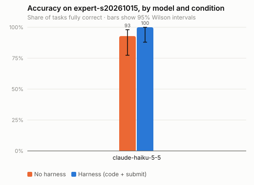
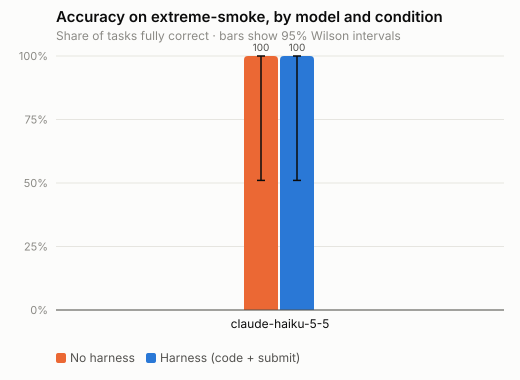
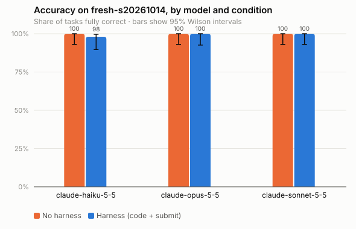
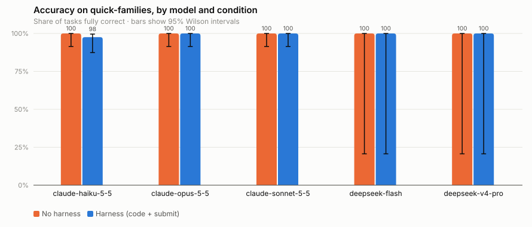
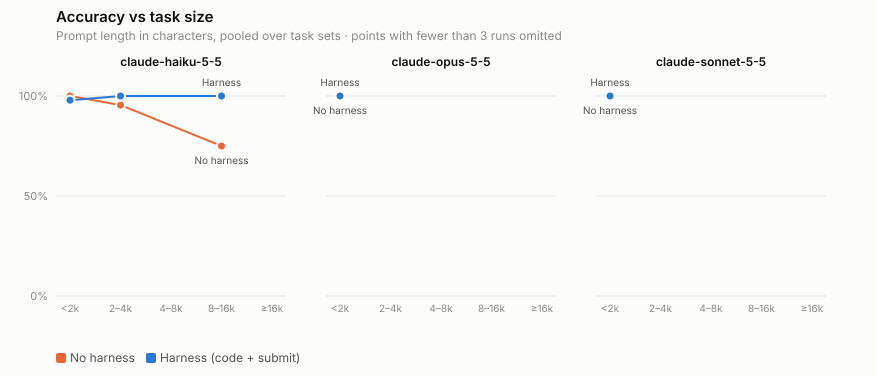
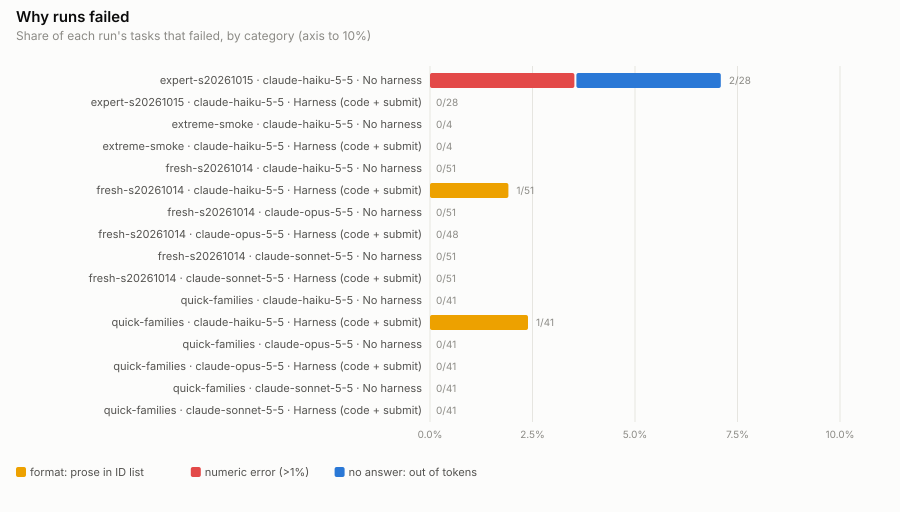
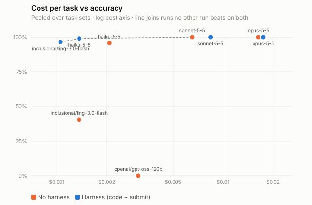

# ConstructBench results

28 run files across 5 task sets.

## Runs

| Set | Model | Condition | Effort | Tasks | Runs | Accuracy (95% CI) | Field | Cost | $/correct | Out tok | s/run |
|---|---|---|---|---|---|---|---|---|---|---|---|
| expert-s20261015 | claude-haiku-5-5 | No harness | high | 28 | 28 | 92.9% (77.4%–98.0%) | 95.7% | $0.0878 | $0.0034 | 5877 | 21.3 |
| expert-s20261015 | claude-haiku-5-5 | Harness (code + submit) | high | 28 | 28 | 100.0% (87.9%–100.0%) | 100.0% | $0.0531 | $0.0019 | 2305 | 13.2 |
| expert84-s20261015 | claude-haiku-5-5 | No harness | high | 84 | 84 | 91.7% (83.8%–95.9%) | 95.1% | $0.2748 | $0.0036 | 6142 | 22.3 |
| expert84-s20261015 | claude-haiku-5-5 | Harness (code + submit) | high | 82 | 82 | 100.0% (95.5%–100.0%) | 100.0% | $0.1548 | $0.0019 | 2280 | 12.0 |
| expert84-s20261015 | deepseek-flash | No harness | — | 84 | 84 | 92.9% (85.3%–96.7%) | 92.9% | — | — | 13960 | 60.6 |
| expert84-s20261015 | deepseek-flash | Harness (code + submit) | — | 84 | 84 | 97.6% (91.7%–99.3%) | 99.0% | — | — | 6069 | 33.6 |
| expert84-s20261015 | inclusionai/ling-3.0-flash | No harness | — | 84 | 84 | 40.5% (30.6%–51.2%) | 46.7% | $0.1145 | $0.0034 | 20980 | 81.0 |
| expert84-s20261015 | inclusionai/ling-3.0-flash | Harness (code + submit) | — | 84 | 84 | 96.4% (90.0%–98.8%) | 98.2% | $0.0885 | $0.0011 | 11237 | 53.7 |
| expert84-s20261015 | openai/gpt-oss-120b | No harness | — | 84 | 10 | 0.0% (0.0%–27.8%) | 32.0% | $0.0310 | — | 15572 | 679.2 |
| expert84-s20261015 | openai/gpt-oss-120b | Harness (code + submit) | — | 84 | 1 | 0.0% (0.0%–79.3%) | 0.0% | — | — | 15162 | 308.9 |
| extreme-smoke | claude-haiku-5-5 | No harness | high | 4 | 4 | 100.0% (51.0%–100.0%) | 100.0% | $0.0163 | $0.0041 | 7245 | 26.4 |
| extreme-smoke | claude-haiku-5-5 | Harness (code + submit) | high | 4 | 4 | 100.0% (51.0%–100.0%) | 100.0% | $0.0097 | $0.0024 | 2461 | 15.3 |
| fresh-s20261014 | claude-haiku-5-5 | No harness | high | 51 | 51 | 100.0% (93.0%–100.0%) | 100.0% | $0.0314 | $0.0006 | 1124 | 4.6 |
| fresh-s20261014 | claude-haiku-5-5 | Harness (code + submit) | high | 51 | 51 | 98.0% (89.7%–99.7%) | 99.0% | $0.0394 | $0.0008 | 888 | 6.6 |
| fresh-s20261014 | claude-opus-5-5 | No harness | high | 51 | 51 | 100.0% (93.0%–100.0%) | 100.0% | $0.8819 | $0.0173 | 758 | 7.2 |
| fresh-s20261014 | claude-opus-5-5 | Harness (code + submit) | high | 48 | 48 | 100.0% (92.6%–100.0%) | 100.0% | $0.8593 | $0.0179 | 365 | 6.9 |
| fresh-s20261014 | claude-sonnet-5-5 | No harness | high | 51 | 51 | 100.0% (93.0%–100.0%) | 100.0% | $0.3560 | $0.0070 | 592 | 4.8 |
| fresh-s20261014 | claude-sonnet-5-5 | Harness (code + submit) | high | 51 | 51 | 100.0% (93.0%–100.0%) | 100.0% | $0.4545 | $0.0089 | 341 | 4.8 |
| quick-families | claude-haiku-5-5 | No harness | high | 41 | 41 | 100.0% (91.4%–100.0%) | 100.0% | $0.0210 | $0.0005 | 946 | 4.2 |
| quick-families | claude-haiku-5-5 | Harness (code + submit) | high | 41 | 41 | 97.6% (87.4%–99.6%) | 98.8% | $0.0246 | $0.0006 | 649 | 5.0 |
| quick-families | claude-opus-5-5 | No harness | high | 41 | 41 | 100.0% (91.4%–100.0%) | 100.0% | $0.6196 | $0.0151 | 677 | 6.6 |
| quick-families | claude-opus-5-5 | Harness (code + submit) | high | 41 | 41 | 100.0% (91.4%–100.0%) | 100.0% | $0.6932 | $0.0169 | 355 | 9.8 |
| quick-families | claude-sonnet-5-5 | No harness | high | 41 | 41 | 100.0% (91.4%–100.0%) | 100.0% | $0.2434 | $0.0059 | 515 | 3.8 |
| quick-families | claude-sonnet-5-5 | Harness (code + submit) | high | 41 | 41 | 100.0% (91.4%–100.0%) | 100.0% | $0.3188 | $0.0078 | 289 | 4.0 |
| quick-families | deepseek-flash | No harness | — | 1 | 1 | 100.0% (20.7%–100.0%) | 100.0% | — | — | 363 | 3.0 |
| quick-families | deepseek-flash | Harness (code + submit) | — | 1 | 1 | 100.0% (20.7%–100.0%) | 100.0% | — | — | 294 | 3.4 |
| quick-families | deepseek-v4-pro | No harness | — | 1 | 1 | 100.0% (20.7%–100.0%) | 100.0% | — | — | 299 | 4.4 |
| quick-families | deepseek-v4-pro | Harness (code + submit) | — | 1 | 1 | 100.0% (20.7%–100.0%) | 100.0% | — | — | 395 | 6.3 |

## Each condition vs the same model's baseline (paired by task)

| Set | Model | Effort | Condition | Tasks | Δ accuracy, pts (95% CI) | Better / worse tasks | p (sign-flip) | p (McNemar) | $/correct vs base |
|---|---|---|---|---|---|---|---|---|---|
| expert-s20261015 | claude-haiku-5-5 | high | Harness (code + submit) | 28 | +7.1 (+0.0 to +17.9) | 2 / 0 | 0.5 | 0.5 | $0.0019 vs $0.0034 |
| expert84-s20261015 | claude-haiku-5-5 | high | Harness (code + submit) | 82 | +7.3 (+2.4 to +13.4) | 6 / 0 | 0.0312 | 0.0312 | $0.0019 vs $0.0036 |
| expert84-s20261015 | deepseek-flash | — | Harness (code + submit) | 84 | +4.8 (-1.2 to +11.9) | 6 / 2 | 0.289 | 0.289 | — vs — |
| expert84-s20261015 | inclusionai/ling-3.0-flash | — | Harness (code + submit) | 84 | +56.0 (+45.2 to +66.7) | 48 / 1 | 5e-05 | 1.78e-13 | $0.0011 vs $0.0034 |
| expert84-s20261015 | openai/gpt-oss-120b | — | Harness (code + submit) | 1 | +0.0 (+0.0 to +0.0) | 0 / 0 | 1 | 1 | — vs — |
| extreme-smoke | claude-haiku-5-5 | high | Harness (code + submit) | 4 | +0.0 (+0.0 to +0.0) | 0 / 0 | 1 | 1 | $0.0024 vs $0.0041 |
| fresh-s20261014 | claude-haiku-5-5 | high | Harness (code + submit) | 51 | -2.0 (-5.9 to +0.0) | 0 / 1 | 1 | 1 | $0.0008 vs $0.0006 |
| fresh-s20261014 | claude-opus-5-5 | high | Harness (code + submit) | 48 | +0.0 (+0.0 to +0.0) | 0 / 0 | 1 | 1 | $0.0179 vs $0.0170 |
| fresh-s20261014 | claude-sonnet-5-5 | high | Harness (code + submit) | 51 | +0.0 (+0.0 to +0.0) | 0 / 0 | 1 | 1 | $0.0089 vs $0.0070 |
| quick-families | claude-haiku-5-5 | high | Harness (code + submit) | 41 | -2.4 (-7.3 to +0.0) | 0 / 1 | 1 | 1 | $0.0006 vs $0.0005 |
| quick-families | claude-opus-5-5 | high | Harness (code + submit) | 41 | +0.0 (+0.0 to +0.0) | 0 / 0 | 1 | 1 | $0.0169 vs $0.0151 |
| quick-families | claude-sonnet-5-5 | high | Harness (code + submit) | 41 | +0.0 (+0.0 to +0.0) | 0 / 0 | 1 | 1 | $0.0078 vs $0.0059 |
| quick-families | deepseek-flash | — | Harness (code + submit) | 1 | +0.0 (+0.0 to +0.0) | 0 / 0 | 1 | 1 | — vs — |
| quick-families | deepseek-v4-pro | — | Harness (code + submit) | 1 | +0.0 (+0.0 to +0.0) | 0 / 0 | 1 | 1 | — vs — |

## Failure categories (runs)

| Set | Model | Condition | Effort | Runs | format: prose in ID list | numeric error (>1%) | near miss (≤1%) | wrong value | no answer: out of tokens | no answer: unparseable | API error |
|---|---|---|---|---|---|---|---|---|---|---|---|
| expert-s20261015 | claude-haiku-5-5 | Harness (code + submit) | high | 28 | 0 | 0 | 0 | 0 | 0 | 0 | 0 |
| expert-s20261015 | claude-haiku-5-5 | No harness | high | 28 | 0 | 1 | 0 | 0 | 1 | 0 | 0 |
| expert84-s20261015 | claude-haiku-5-5 | Harness (code + submit) | high | 82 | 0 | 0 | 0 | 0 | 0 | 0 | 0 |
| expert84-s20261015 | claude-haiku-5-5 | No harness | high | 84 | 0 | 4 | 0 | 0 | 3 | 0 | 0 |
| expert84-s20261015 | deepseek-flash | Harness (code + submit) | — | 84 | 0 | 2 | 0 | 0 | 0 | 0 | 0 |
| expert84-s20261015 | deepseek-flash | No harness | — | 84 | 0 | 0 | 0 | 0 | 5 | 1 | 0 |
| expert84-s20261015 | inclusionai/ling-3.0-flash | Harness (code + submit) | — | 84 | 0 | 0 | 1 | 2 | 0 | 0 | 0 |
| expert84-s20261015 | inclusionai/ling-3.0-flash | No harness | — | 84 | 0 | 7 | 3 | 0 | 32 | 8 | 0 |
| expert84-s20261015 | openai/gpt-oss-120b | Harness (code + submit) | — | 84 | 0 | 0 | 0 | 0 | 0 | 1 | 83 |
| expert84-s20261015 | openai/gpt-oss-120b | No harness | — | 84 | 0 | 0 | 0 | 6 | 1 | 3 | 74 |
| extreme-smoke | claude-haiku-5-5 | Harness (code + submit) | high | 4 | 0 | 0 | 0 | 0 | 0 | 0 | 0 |
| extreme-smoke | claude-haiku-5-5 | No harness | high | 4 | 0 | 0 | 0 | 0 | 0 | 0 | 0 |
| fresh-s20261014 | claude-haiku-5-5 | Harness (code + submit) | high | 51 | 1 | 0 | 0 | 0 | 0 | 0 | 0 |
| fresh-s20261014 | claude-haiku-5-5 | No harness | high | 51 | 0 | 0 | 0 | 0 | 0 | 0 | 0 |
| fresh-s20261014 | claude-opus-5-5 | Harness (code + submit) | high | 48 | 0 | 0 | 0 | 0 | 0 | 0 | 0 |
| fresh-s20261014 | claude-opus-5-5 | No harness | high | 51 | 0 | 0 | 0 | 0 | 0 | 0 | 0 |
| fresh-s20261014 | claude-sonnet-5-5 | Harness (code + submit) | high | 51 | 0 | 0 | 0 | 0 | 0 | 0 | 0 |
| fresh-s20261014 | claude-sonnet-5-5 | No harness | high | 51 | 0 | 0 | 0 | 0 | 0 | 0 | 0 |
| quick-families | claude-haiku-5-5 | Harness (code + submit) | high | 41 | 1 | 0 | 0 | 0 | 0 | 0 | 0 |
| quick-families | claude-haiku-5-5 | No harness | high | 41 | 0 | 0 | 0 | 0 | 0 | 0 | 0 |
| quick-families | claude-opus-5-5 | Harness (code + submit) | high | 41 | 0 | 0 | 0 | 0 | 0 | 0 | 0 |
| quick-families | claude-opus-5-5 | No harness | high | 41 | 0 | 0 | 0 | 0 | 0 | 0 | 0 |
| quick-families | claude-sonnet-5-5 | Harness (code + submit) | high | 41 | 0 | 0 | 0 | 0 | 0 | 0 | 0 |
| quick-families | claude-sonnet-5-5 | No harness | high | 41 | 0 | 0 | 0 | 0 | 0 | 0 | 0 |
| quick-families | deepseek-flash | Harness (code + submit) | — | 1 | 0 | 0 | 0 | 0 | 0 | 0 | 0 |
| quick-families | deepseek-flash | No harness | — | 1 | 0 | 0 | 0 | 0 | 0 | 0 | 0 |
| quick-families | deepseek-v4-pro | Harness (code + submit) | — | 1 | 0 | 0 | 0 | 0 | 0 | 0 | 0 |
| quick-families | deepseek-v4-pro | No harness | — | 1 | 0 | 0 | 0 | 0 | 0 | 0 | 0 |

## Figures

Costs are client-side estimates from token usage × list price (Claude); runs without a recorded cost are left out of cost columns and the Pareto figure. Accuracy CIs are Wilson intervals over runs; paired differences use the task as the unit (repeats averaged) with a bootstrap CI.
